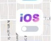
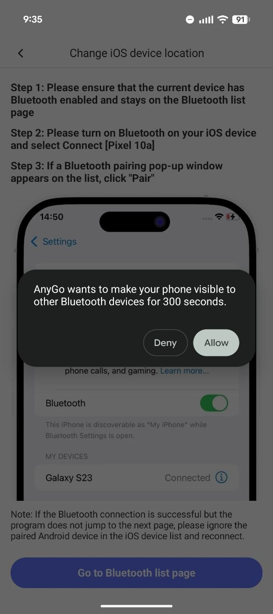
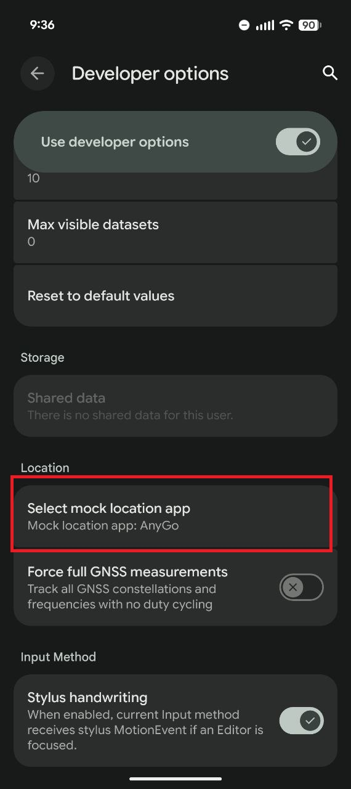
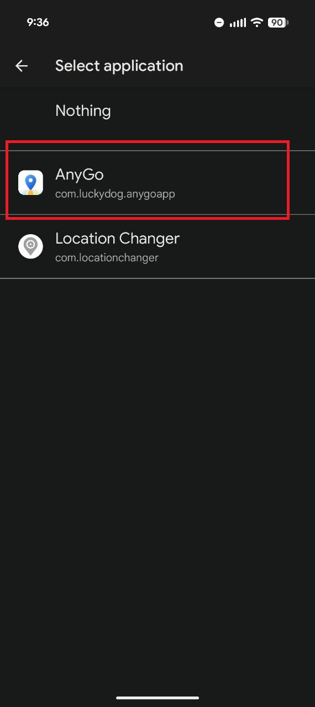
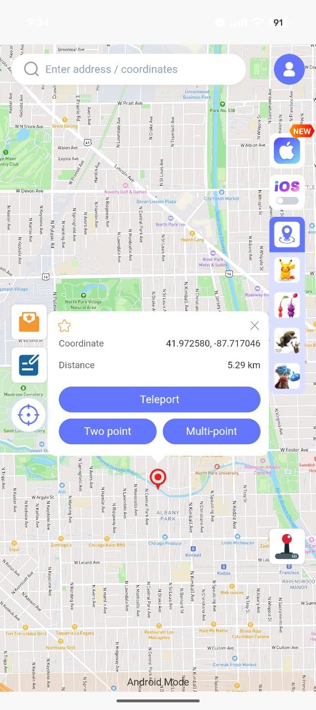

<h1>📍 iPhone GPS Setup with iAnyGo</h1>

<strong>Your iPhone. Your chosen location. Controlled from Android.</strong>

A step-by-step guide to changing your iPhone’s location using iAnyGo on an Android device.

  <a href="#requirements">Requirements</a> ·
  <a href="#step-by-step-setup">Setup guide</a> ·
  <a href="#troubleshooting">Troubleshooting</a>

---

> [!IMPORTANT]
> **The iPhone is your main device.** Run Amazon Flex on the iPhone for Instant Offers, check-in, deliveries, and other location-based actions. Use the Android device to select and change the iPhone’s location through iAnyGo.

> [!CAUTION]
> **Do not use the PC edition of iAnyGo for this setup.** In the setup described here, both **USB** and **Wi-Fi** connections through the PC edition trigger the GPS detection screen. Follow the Android-to-iPhone Bluetooth method below.

## Requirements

You’ll need three things:

| Item | Role |
| :--- | :--- |
| **iPhone** | Your main device for Amazon Flex. |
| **Android device** | Controls the location and pairs with your iPhone over Bluetooth. |
| **iAnyGo for Android** | The location-changing app, downloaded from Google Play. |

## Step-by-step setup

### 1. Install iAnyGo on Android

Download **iAnyGo** from the **Google Play Store** on your Android device, then open the app.

### 2. Select iOS mode

In iAnyGo, tap **iOS** in the menu on the **right side** of the screen.

  

### 3. Pair your iPhone and Android device

Follow iAnyGo’s Bluetooth pairing prompts:

1. Turn on **Bluetooth** on both phones.
2. On Android, allow the phone to become visible to nearby Bluetooth devices when prompted.
3. On your iPhone, open **Settings → Bluetooth** and select your Android device.
4. Confirm the **Pair** prompts on both phones.

  

### 4. Set iAnyGo as the mock location app

iAnyGo will prompt you to select a mock location app and guide you to the appropriate Android settings.

Open **Developer options → Select mock location app**, then choose **AnyGo**.

> [!NOTE]
> In Android’s application list, iAnyGo appears as **AnyGo**, as shown below.

<table>
  <tr>
    <th>Open “Select mock location app”</th>
    <th>Choose “AnyGo”</th>
  </tr>
  <tr>
    <td align="center">
      
    </td>
    <td align="center">
      
    </td>
  </tr>
</table>

### 5. Choose your location

Once the phones are paired and setup is complete:

1. Return to **iAnyGo on Android** and make sure **iOS mode** is selected.
2. Choose a location on the map or enter **GPS coordinates** in the search field.
3. Apply the location change in iAnyGo.

The selected location will be applied to your **paired iPhone**. Continue using Amazon Flex on the iPhone.

  
   
  <em>Map screen shown for reference. Select iOS mode before changing your iPhone’s location.</em>

## Troubleshooting

| Issue | What to do |
| :--- | :--- |
| **The Bluetooth pairing prompt does not appear.** | Allow Bluetooth visibility on Android, keep the Bluetooth settings page open, and select the Android device from your iPhone. |
| **Bluetooth connects, but iAnyGo does not continue.** | As suggested on iAnyGo’s pairing screen, forget the Android device in your iPhone’s Bluetooth settings, then pair again. |
| **You cannot find “iAnyGo” in the mock location list.** | Look for **AnyGo** — that is the name shown in the supplied screenshots. |
